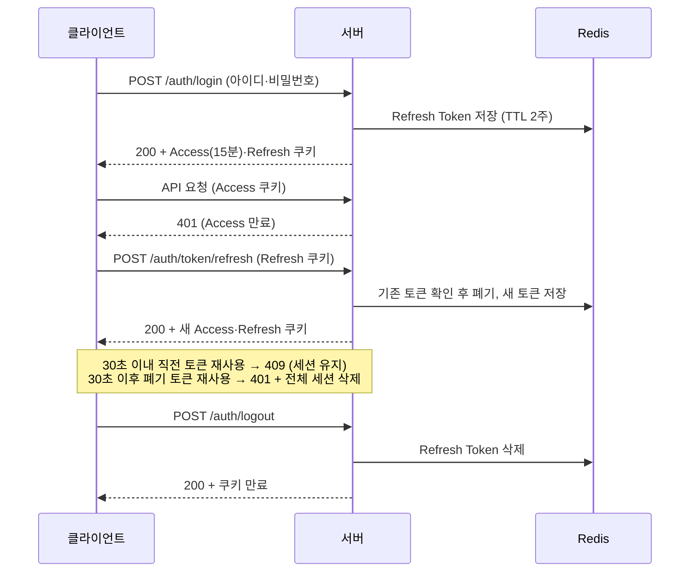

# artcation 회원 인증 설계 (발췌본)

공연 아티스트와 호스트를 연결하는 팀 프로젝트 **artcation**에서 제가 맡은
**회원 인증(USR-AUTH) 도메인**의 기획 문서와, 그중 직접 구현한
**인증 토큰(JWT 발급·재발급·폐기)** 파트의 명세·API 계약 문서입니다.

> 원본은 팀의 private 저장소(`artcation_docs`)에 있으며, 이 저장소는 포트폴리오용으로
> **본인 담당 부분만 발췌**해 새로 구성했습니다. 프로젝트는 현재 진행 중입니다.

- **API 계약 보기:** [Swagger UI](./index.html) (GitHub Pages로 열면 브라우저에서 바로 볼 수 있습니다)
- **담당 범위**
  - 설계: 회원 인증(USR-AUTH) 도메인의 intent·spec·OpenAPI 계약 초안 작성, 이후 팀 리뷰를 거쳐 함께 다듬음
  - 구현: 로그인 시 토큰 발급, 로그아웃 시 폐기, Access Token 재발급(Refresh Token Rotation), 비밀번호 변경 시 세션 무효화

> 수록한 문서는 팀 리뷰가 반영된 최종 버전이라, 일부 문구는 팀원이 수정한 내용을 포함합니다.

---

## 작업 방식: AI와 함께 "왜 → 무엇 → 계약" 순서로 설계

팀은 Claude를 활용한 AI-Native 개발 흐름을 따랐습니다. 코드를 먼저 쓰지 않고,
문서를 단계별로 구체화한 뒤 그 문서를 기준으로 구현합니다.

| 단계 | 산출물 | 하는 일 |
|---|---|---|
| 1. Plan | [`intent/USR-AUTH.md`](./intent/USR-AUTH.md) | Claude와 대화하며 **문제와 원하는 결과**를 정의 (인증 도메인 전체) |
| 2. Design | [`spec/USR-AUTH-token.md`](./spec/USR-AUTH-token.md) | intent의 기능을 **트리거·처리 로직·예외 케이스** 수준으로 구체화 |
| 3. Contract | [`openapi.yaml`](./openapi.yaml) | spec이 확정된 뒤에만 **API 계약**으로 옮김 |

각 단계는 Claude Code의 커스텀 스킬(`/intent`, `/spec`)로 진행했고, 스킬에는 다음 규칙을 두어
AI가 그럴듯한 내용을 지어내지 못하게 했습니다.

- 사용자가 말하지 않은 내용은 본문에 적지 않고 **열린 질문**으로 남긴다.
- spec에는 구현 방법(테이블, 라이브러리)이 아니라 **무엇을 판단하는지**만 적는다.
- **예외 케이스가 비어 있는 spec은 완성으로 보지 않는다.**
- spec이 승인되기 전에는 API를 그리지 않는다.

### AI 제안과 최종 결정이 달랐던 사례

**이메일 인증 시점: "가입 후 인증" → "인증 후 계정 생성"**

AI의 첫 명세 초안은 계정을 먼저 만들고 이메일 인증을 나중에 받는 방식이었습니다.
검토해 보니 이 방식은 미인증 계정의 로그인 허용 범위, 방치 계정 삭제 주기,
같은 이메일 재가입 시 충돌 처리처럼 예외 정책이 계속 늘어났습니다.

두 방식을 비교하는 결정 문서를 따로 작성해 검토한 뒤, **인증을 마친 이메일만 계정을 생성**하도록 바꿨습니다.
인증 상태는 Redis에 TTL로 임시 저장해, 유령 계정과 그에 딸린 후속 정책 자체를 없앴습니다.

**토큰 설계로 이어진 점:** 이때 도입한 Redis를 Refresh Token 저장소로도 재사용했습니다.
Rotation으로 토큰이 자주 교체되기 때문에, 만료를 TTL로 처리할 수 있는 Redis가 DB 테이블보다 적합했습니다.

---

## 핵심 설계 결정

| 항목 | 결정 | 이유 |
|---|---|---|
| 토큰 방식 | JWT, Access·Refresh Token 분리 | 짧은 Access Token으로 탈취 피해를 줄이고, Refresh Token으로 로그인 유지 |
| 저장 위치 | `httpOnly; Secure; SameSite=Lax` 쿠키 | JS에서 토큰을 읽을 수 없어 XSS로 인한 탈취를 막음. 대신 로그인 상태는 내 정보 조회 API로 확인 |
| Access Token 만료 | 15분 | 탈취되더라도 사용 가능한 시간을 짧게 제한 |
| Refresh Token 만료 | 슬라이딩 2주 + 절대 60일 | 자주 쓰는 사용자는 로그인이 유지되지만, 60일이 지나면 반드시 재로그인 |
| Rotation | 재발급할 때마다 Refresh Token 교체, 기존 토큰 폐기 | 폐기된 토큰이 다시 쓰이면 탈취로 판단할 수 있음 |
| 탈취 감지 | 폐기된 토큰 재사용 시 해당 계정의 모든 Refresh Token 삭제 | 공격자와 정상 사용자 중 누가 썼는지 알 수 없으므로 전체 세션 종료 |
| 동시 요청 유예 | 교체 후 30초 이내 직전 토큰 재사용은 409로 거부만 하고 세션 유지 | 여러 탭이나 네트워크 재시도 때문에 정상 사용자가 로그아웃되는 문제 방지 |
| 서버 저장소 | Redis | 로테이션이 잦아 TTL로 만료를 처리하는 게 유리 |
| 로그아웃 | 멱등 처리 (토큰이 없거나 만료돼도 200) | 클라이언트가 상태와 상관없이 안전하게 호출 가능 |
| 실패 응답 | 아이디 없음·비밀번호 불일치·탈퇴 계정을 구분하지 않음 | 계정 존재 여부 노출 방지 |
| 비밀번호 변경 | 해당 계정의 Refresh Token 전체 삭제 | 비밀번호가 바뀌면 기존 세션을 모두 끊음 |

---

## 토큰 흐름



---

## 저장소 구성

```
.
├── README.md
├── intent/USR-AUTH.md         # 1단계: 문제와 목표 (인증 도메인 전체)
├── spec/USR-AUTH-token.md     # 2단계: 기능 명세 USR-AUTH-004·005·006
├── openapi.yaml               # 3단계: API 계약 (로그인·로그아웃·재발급)
└── index.html                 # Swagger UI 뷰어
```

## API 계약 로컬에서 보기

```bash
npx http-server . -p 4000   # 또는 python3 -m http.server 4000
# 브라우저에서 http://localhost:4000 접속
```
